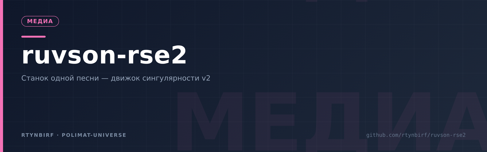
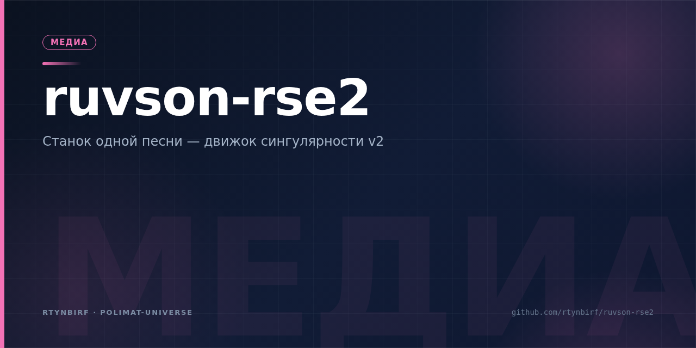

  

# RUVSON SINGULARITY ENGINE v2 (RSE-2)

   

Станок одной песни: шаги 0–6 — от минуса до мастера. Голос RUVSON.
Конвейер на мировых трендах 2023–2026 (Mel-Band RoFormer, Seed-VC,
OpenVoice+петля, kNN-VC, CREPE-судья).

## Вход для человека

- **[00_ГЛАВНАЯ.md](00_ГЛАВНАЯ.md)** — карта проекта, начать отсюда.
- **[01_ТЗ_ТЕХНИЧЕСКОЕ_ЗАДАНИЕ.md](01_ТЗ_ТЕХНИЧЕСКОЕ_ЗАДАНИЕ.md)** — что строим.
- **[02_ДОРОЖНАЯ_КАРТА.md](02_ДОРОЖНАЯ_КАРТА.md)** — порядок шагов 0–6.
- **[05_ПРИЁМКА_БЕНЧМАРКИ.md](05_ПРИЁМКА_БЕНЧМАРКИ.md)** — как проверяем.
- **[11_СВЕРКА_ТРЕНДОВ.md](11_СВЕРКА_ТРЕНДОВ.md)** — сверка с трендами (41/41).

## Статус

Живой конвейер: Ф-0 выполнен (минус demucs), ревизия №2 — roformer-веса
скачаны, минус прошёл полную песню. Пробы и улики — в `evidence/`.

## Лицензия

MIT — см. [LICENSE](LICENSE).
